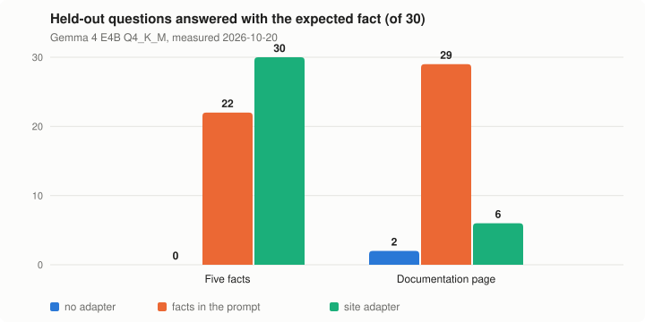

<h1 align="center">chromium-lora</h1>

<p align="center"><b>A Chromium fork in which Chrome's own Prompt API runs Gemma 4 locally and gives each
website its own LoRA adapter, granted by the user and pinned to the model version.</b></p>

<p align="center">Research build. Chromium 155, macOS on Apple Silicon. Everything runs on your Mac; no account, no server, no telemetry.</p>

<p align="center">


</p>

## Install

| What you want to see | What it takes |
|---|---|
| The backend switching adapters per session, no browser | llama.cpp, the backend, Gemma 4 E4B (5 GB): about an hour |
| Per-site adapters in the browser | The above, plus a Chromium 155 checkout (about 100 GB) and build: several hours |

```bash
git clone https://github.com/NakliTechie/chromium-lora && cd chromium-lora
git clone --depth 1 --branch b9830 https://github.com/ggml-org/llama.cpp.git ../llama.cpp
fork/backend/build-llama.sh ../llama.cpp                     # llama.cpp libraries and tools
fork/backend/build-standalone.sh ../llama.cpp out            # the backend and its test, outside Chromium
```

Then convert Gemma 4 E4B, train the example site's adapter from its recipe, and run the backend test
(M1): it answers the same 50 questions with and without the adapter and scores them. The full
steps, including the browser build, are in [`fork/README.md`](fork/README.md#build). No prebuilt
browser or adapter is published yet; you build both.

## Why

Your site wants the browser's built-in model to answer in your brand's voice and know your fixed
facts, without sending a long brand guide in every prompt. Chrome's Prompt API gives every site the
same model. This fork tests the missing piece: a per-site LoRA adapter that the browser chooses by
origin, applies only after the user allows it, and refuses when the model changes.

It tests three objections: adapters break on model updates, adapters on untrusted sites are
unsafe, and the approach may not carry to other browsers. The first two have measured answers
below; portability is a design property no test has checked.

## Results



An adapter teaches a handful of facts better than the prompt: 30 of 30 against 22 of 30. It does
not teach a documentation page: 6 of 30, against 29 of 30 with the page in the prompt at 3,366 extra
tokens per session. Adapters suit a site's voice and fixed facts; content belongs in the context.
Numbers in [`fork/results/results.json`](fork/results/results.json); the chart is drawn by
`python3 fork/tools/results_chart.py`.

Other checks, all run on 2026-10-20 on Gemma 4 E4B unless named:
- **Model updates (M4), 13 of 13.** One published recipe rebuilt the adapter on Gemma 4 E4B, then on
  Qwen2.5-3B, with no manual step, in 3 to 4 minutes each. The new model refused the old adapter and
  answered on the base model until the rebuild.
- **User permission (M5), 7 of 7.** The adapter runs only after the user grants that site; denied
  or revoked sites get the base model.
- **Frames and revocation, 7 of 7.** A frame from another site gets the base model; revoking ends
  open sessions.
- **Review, 9 of 9.** Three bad test recipes were rejected, including a sales pitch that appears
  only after a trigger phrase.

## How a site gets an adapter

The site publishes a recipe at `/.well-known/model-adapter.json`: example questions and answers,
plus ordinary questions the model should keep answering normally. A builder trains a LoRA on the
current base model, stamps it with that model's version, and reviews it. The browser picks the
adapter by the page's origin and uses it only after the user allows that site. A new model release
means a rebuild from the same recipe.

In this fork the builder stands in for a build service. The direction under discussion is that the
site builds and hosts one adapter per model release, the browser announces its model version, and
the browser contains the adapter instead of reviewing it.

## What the browser enforces

- An adapter stamped for another model version is never applied; the session uses the base model.
- Only pages of the adapter's own site can use it; a frame from another site cannot.
- The user grants or blocks each site's adapter through a permission prompt, and can revoke it.
- The page reads the model version from `LanguageModel.params().modelVersion`.

## Commands

```bash
fork/backend/build-llama.sh <llama.cpp>                    # llama.cpp at b9830: libraries, quantize, server
fork/backend/build-standalone.sh <llama.cpp> <out>         # backend and m1_test outside Chromium
python3 fork/pipeline/build_base.py <hf dir> <llama.cpp> <out.gguf> # Hugging Face checkpoint to GGUF, version-stamped
fork/pipeline/.venv/bin/python fork/pipeline/build_adapter.py <recipe> ...  # train one site's LoRA (MLX)
python3 fork/pipeline/build_site_adapters.py --review ... ORIGINS  # discover recipes, build, review, write manifest
fork/apply.sh <chromium/src> <llama.cpp> <out dir>         # patch Chromium 155 and add the backend
python3 fork/tools/results_chart.py                         # redraw the results chart
```

## Verify it yourself

```bash
PY=fork/pipeline/.venv-convert/bin/python
$PY fork/backend/test/m1_check.py ...    # backend: adapter on and off, clone, cancel, version refusal
$PY fork/m3/m3_check.py ...              # per-site adapters and version pinning in the browser
$PY fork/m4/m4_check.py ...              # rebuild from the recipe when the model changes
$PY fork/m5/m5_check.py ...              # user permission
$PY fork/m5/lifecycle_check.py ...       # frames and revocation
$PY fork/m5/review_check.py ...          # review rejects bad recipes
$PY fork/pipeline/test_builder.py        # builder unit tests
```

Each check exits non-zero unless every gate passes, and prints its report. The full argument
lists are in [`fork/README.md`](fork/README.md#results). A fresh clone was tested on 2026-10-22:
the requirements resolve, llama.cpp builds, M1 passes, and the four patches apply to unmodified
Chromium 155.0.8059.84. A from-scratch Chromium build was not repeated.

## License

Apache-2.0. Gemma 4 is Apache-2.0; Qwen2.5-3B, used only for the model-update test, is under the
Qwen Research licence.

[Fork details and known limits](fork/README.md) · [Earlier LiteRT-LM research](docs/litert-lm-research.md) · [Findings](docs/findings.md) · [Questions for the Chromium team](docs/ask-chromium.md)
